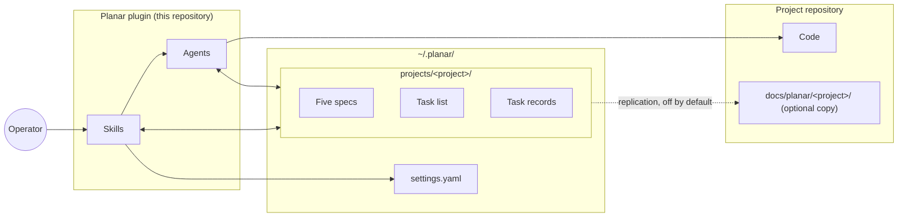

# Architecture

This document describes how Planar is put together. It is written for people
and is kept in step with the system: when the system changes, this document
changes with it.

> **Status.** Planar is being built. This document describes the design as
> decided so far. Nothing here is implemented yet, and parts marked
> *provisional* may change before they are.

For how the pieces are used, see [methodology.md](methodology.md).

## The short version

Planar is a Claude Code plugin. It has three kinds of parts:

- **Skills** carry the workflow: how to draft specs, how to check them, how
  to run a task.
- **Agents** do bounded jobs with a fresh context: implement one task,
  review one result, review one spec set.
- **Markdown files** hold everything that must outlast a session: specs,
  the task list, and a record for each task.

There is no engine binary, no database and no compiled format. In the first
versions there are no scripts either. Every step is done by a skill or an
agent, and that choice is reviewed once there is experience to judge it by.



## Where things live

### The plugin

The plugin lives in this repository and is distributed through Claude Code's
plugin system. It holds the skills and agents, this documentation, and an
example settings file.

### The Planar directory

Everything Planar writes for a user goes under `~/.planar/` by default.

```text
~/.planar/
├── settings.yaml            user settings (optional)
└── projects/
    └── <project>/           one self-contained directory per project
        ├── prd.md
        ├── tech-spec.md     provisional name
        ├── layout.md        provisional name
        ├── testing-spec.md  provisional name
        ├── tasks.md         the task list
        └── tasks/
            └── <task>.md    one record per task
```

Each project has one directory under `projects/`, so a project is easy to
find and the top level stays uncluttered. A project directory is
self-contained: its specs, its task list and its task records are all there.

By default Planar puts nothing in the project's own repository.

### Project names

The `<project>` name is chosen in one of three ways:

| Method | Example | When |
| --- | --- | --- |
| Derived from context | `widgets` | The default. Taken from the repository or the operator's description of the work. |
| Tracker key and task | `ABC-123-add-export` | When settings prefer it and the work comes from a tracker issue. |
| Given by the operator | `billing-v2` | Whenever the operator names it. This always wins. |

Planar tells the operator the name before writing anything. If the name
already exists for different work, Planar asks what to do and offers an
example, such as adding a number suffix. It does not decide for the operator.

### Settings

Settings are read from one user file, `~/.planar/settings.yaml`. The file is
optional. Without it, the defaults described in this document apply.

Settings cover:

- where the Planar directory is, if not `~/.planar/`;
- the preferred project naming method;
- replication, per project.

The repository ships an example settings file holding the maintainer's own
preferences.

### Replication

Because specs live outside the repository, they are not versioned or
published with the code. That is the accepted default.

For a project where the specs should travel with the code, replication can be
turned on in settings. An agent step then copies that project's Planar files
into the repository, by default under `docs/planar/<project>/`. The first
copy is made when the operator approves the spec set. After that, the copy is
refreshed as tasks complete and update the files. Replication is:

- **off by default**, and turned on per project;
- **one way**: the files under `~/.planar/` remain the source of truth;
- **a copy**: regular files, not links, placed as they are and not rewritten.

## The files

### Specs

A project has five specs, all Markdown:

| Spec | Answers |
| --- | --- |
| PRD | What is wanted, and why? Includes acceptance scenarios in Gherkin. |
| Tech spec | How will it be built? |
| Layout | Which files and directories exist or will exist, and what does each hold? |
| Testing spec | How is each requirement checked? |
| Tasks | What are the units of work, in order? |

Three rules make the specs usable by agents that have not seen the
conversation:

- **Stable section IDs.** Any section another document may refer to has an
  ID, such as `PRD-R9`, that never changes. A section that is dropped is
  marked withdrawn, not renumbered.
- **Evidence.** A factual claim cites its source: a file and section, a file
  and line, or a dated operator decision. A claim with no source is marked
  as an assumption.
- **Open questions.** Each spec lists its open questions with IDs, and
  records the operator's answers with a date.

Diagrams are written in Mermaid inside the Markdown.

### The task list

The task list says what each task is. The only state it holds is a checkbox
per task: done or not done. It is a declaration of the work, not a log of it.

### Task records

Each task has its own file under `tasks/`. The record holds that task's
state and the history of how it was carried out: the packets rendered,
each worker attempt, the check results, each reviewer verdict, and where the
work stopped. It is updated as the work proceeds.

This split keeps the two concerns apart. The task list changes when the plan
changes. A task record changes when work happens. A new session reads the
task list to find what is next and the task record to find how far it got.

### Packets

A packet is the complete input for one agent doing one job.

- A **worker packet** holds the task, the spec sections it cites, the files
  it may touch and the checks it must pass.
- A **reviewer packet** holds the task, the cited spec sections, the diff and
  the check results.

A packet must be enough by itself. A worker that needs to ask for missing
context is a sign the packet, or the specs behind it, are incomplete.

## Agents

| Agent | Job | Does not |
| --- | --- | --- |
| Spec reviewer | Judges a drafted spec set for completeness, fit to the operator's intent, gaps and test coverage. | Rewrite the specs. |
| Worker | Implements one task from its packet and returns the change. | Approve its own work. |
| Reviewer | Judges one task's result against the cited spec sections. Returns approve, request changes, or open question. | Implement fixes. |

The session the operator is talking to is the orchestrator. It runs the
skills, dispatches the agents, runs the checks itself and reports back.

## Two ways to run the loop

The execution loop can be driven in two ways:

- **Skill mode.** Planar's own orchestration skill drives the loop using only
  skills and subagents.
- **Workflow mode.** A Claude Code dynamic workflow drives the same loop.

Skill mode is complete by itself, because some organizations do not allow
workflows and some harnesses do not have them. Both modes use the same
packets, the same agents and the same task records, so a task started in one
mode can be continued in the other.

## What is deliberately missing

- **No engine, database or compiled format.** When a step would have been
  safer, faster or simpler with one, the gap is written down with the
  evidence for it. Nothing is built until that record justifies it.
- **No claims or leases.** One session works a project at a time.
- **No issue tracker sync.** A tracker key can name a project, and that is
  all.
- **No support for other harnesses yet.** The design keeps skill mode free of
  Claude-only features so that this stays possible.
