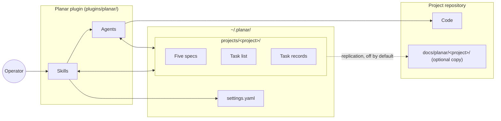

# Architecture

This document describes how Planar is put together. It is written for people
and is kept in step with the system: when the system changes, this document
changes with it.

> **Status.** The plugin contains the skills, agents, profiles, references and
> workflow described here. Claude end-to-end scenarios remain to be verified;
> the Codex minimal loop and shared profile are implemented but integration is
> not yet verified. Descriptions of execution below are the instructions the
> plugin provides, not claims that every scenario has passed.

For how the pieces are used, see [methodology.md](methodology.md).

The Codex host contract and its bounded capability evidence are
summarized in [hosts.md](../plugins/planar/references/hosts.md). The local app-server and
native collaboration probes establish separate primitives, not a complete
Planar integration or cross-host handoff. No engine or shipped runner is
added for this support.

## The short version

Planar packages the same Markdown core for Claude Code and the intended minimal
Codex loop. Codex integration remains to be verified. It has five
kinds of parts:

- **Skills** carry the method: how to draft specs, how to check them, how
  to run a task.
- **Agents** do bounded jobs with a fresh context: plan the tasks, implement
  one task, review one result, review one spec set.
- **Profiles** say which stages the work goes through and which agent and
  model does each.
- **References** are the single definition of each format and rule, read
  by skills and agents alike.
- **Markdown files** hold everything that must outlast a session: specs,
  the task list, and a record for each task.

There is no engine binary, no database and no compiled format. Planar ships
no scripts, apart from one workflow script that only puts agents in order.
Every step is done by a skill or an agent, and that choice is reviewed once
there is experience to judge it by. An agent may still write a throwaway
script to get a step done.



## Where things live

### The plugin

The plugin lives under `plugins/planar/`. Its Claude manifest supports Claude
Code distribution; a portable root `plugin.json` identifies the same
package for Codex. A discovered installed skill bootstraps the host contract
relative to its own directory; subsequent bundled links resolve from the
package root. Codex dispatch loads the complete bundled role instructions into
a fresh context with bounded inputs and required restrictions. The actual Planar
installation, discovery and role loading remain to be verified. The scratch
local marketplace procedure and its limited evidence are described in the
[README](../README.md#installation-and-status) and host contract. Its manifest,
skills, agents, profiles and references are scoped to that directory; future
workflows and example settings belong there too. The manifest keeps the `planar` namespace.

The repository-level `.claude-plugin/marketplace.json` points to
`./plugins/planar`. The README, repository guidance and this documentation
stay at the repository root, so another plugin can have its own directory
under `plugins/` and manifest namespace. For local development, load the plugin with
`claude --plugin-dir ./plugins/planar` from the repository root.

### The Planar directory

Everything Planar writes for a user goes under `~/.planar/` by default. Setting
`PLANAR_HOME` to an existing directory moves the default home, settings file
included. Settings can also override the projects directory or an individual
project path.

```text
~/.planar/
├── settings.yaml            user settings (optional)
└── projects/
    └── <project>/           one self-contained directory per project
        ├── project.yaml     the project's identity and spec approval status
        ├── context.md       what the operator asked for, sources, decisions
        ├── prd.md
        ├── tech-spec.md
        ├── layout.md
        ├── testing-spec.md
        ├── tasks.md         the task list
        ├── ids.md           every section ID ever issued
        ├── gaps.md          the gap log
        ├── decisions.md     decisions taken for the operator in autonomous runs
        ├── reviews/         spec check and spec review reports
        ├── tasks/
        │   └── <task>/      one directory per task
        │       ├── record.md
        │       └── …        plan, symbol maps, packets, reports, check results, reviews
        ├── scratch/
        │   └── scratch-<purpose>/  local scratch
        └── worktrees/
            └── wt-<project>/  default named git worktree
```

A project is one piece of work, not one repository: a repository can have
many projects. Each has one directory under `projects/`, so a project is
easy to find and the top level stays uncluttered. A project directory is
self-contained: its specs, its task list and its task records are all there.

By default Planar puts nothing in the project's own repository.

### Project names

The `<project>` name is chosen in one of three ways:

| Method | Example | When |
| --- | --- | --- |
| Derived from context | `add-colour-list` | The default. A short slug of the operator's description of the work, or the repository name if that gives nothing better. |
| Tracker key and task | `ABC-123-add-export` | When settings prefer it and the work comes from a tracker issue. |
| Given by the operator | `billing-v2` | Whenever the operator names it. This always wins. |

Planar tells the operator the name before writing anything. If the
repository already has projects, Planar lists them and asks whether to
continue one or start a new one. If the name is already taken, it asks what
to do and offers an example, such as adding a number suffix. It does not
decide for the operator.

### Settings

Settings are read from one user file, `~/.planar/settings.yaml`. The file is
optional. Without it, the defaults described in this document apply.

Settings cover:

- where the projects directory is, if not `~/.planar/projects/`;
- the preferred project naming method;
- which orchestration mode and which profile to use;
- whether runs may be autonomous, and how many decisions an autonomous run
  may take for the operator;
- policies;
- per project: its profile, its policy, any extra spec review lenses, and
  replication.

A **policy** is a named set of rules for what is allowed. The first rules
are whether each approved task is committed and where the work is done. The
built-in `default` policy commits each approved task, without pushing, and
does the work in a selected named git worktree on its own branch. Its parent
resolves from project `worktrees_dir`, global `worktrees_dir`, then the project
directory’s `worktrees/`; the default child is `wt-<project>`. Recorded trees,
including legacy `worktree/`, are resumed without an implicit move. A project can name a different policy, for example
one that works in the repository's own checkout. Planar never merges or
pushes; the operator does.

### Profiles

A **profile** is a YAML file that says how the work is staged: which stages
run, which agent and model does each, how many revision rounds are allowed,
and whether tasks are coded one at a time or in parallel. Policies say what
is allowed; profiles say how the work is done. Profiles exist so that
different ways of working can be tried and compared. Three ship with the
plugin, and an operator can add their own under `~/.planar/profiles/`.

| Profile | What it does |
| --- | --- |
| `minimal` | The session drives. One worker, the checks, one reviewer. One task at a time. |
| `basic` | An orchestrator agent drives. A planner writes a plan for every task first. Before each task a mapper writes a symbol map. Workers start on a small model and move up after a failed review. Two reviewers, one for fit to the spec and one for correctness. |
| `basic-parallel` | As `basic`, with every ready task coded at the same time, provided the tasks touch different files. |

Every task record notes the profile and the model used at each step, so two
runs can be compared afterwards.

The repository ships an example settings file. A user profile of the same
name replaces the shipped profile. The shared `minimal` profile contains
explicit Claude and Codex model and effort bindings; missing required bindings
block dispatch. The Codex profile and handoff contract remain unverified in
the complete Planar loop.

### Recovery and handoff

Task records, numbered artifacts, approved specs and the working tree carry
recovery state across sessions and hosts. The receiving session verifies the
approval, tree, profile and attribution, reconciles complete files with their
logs, and reports the next unfinished step before dispatch. It requires the
previous driver and children to have stopped, but no old chat or source-vendor
model call. Partial work is retained; a partial worker, check or review is
restarted according to its boundary, while completed applicable evidence and
pending check batches are preserved. Approval and commit bookkeeping is
reconciled without duplication. A required unavailable host check stays pending
and blocks approval. A profile switch affects future dispatches only and must
retain required stages. Live interrupted handoff in both directions remains
unverified.

### Resource lifecycle

The shared [lifecycle reference](../plugins/planar/references/lifecycle.md)
defines ownership, evidence retention and teardown for both drivers (TS-19.9).
Records and immutable cleanup reports carry outcomes and recovery actions;
they are Markdown bookkeeping, not a registry or cleanup engine. Host
capabilities determine whether an individual child can be retired.

### Progress and last observation

Drivers follow the [lifecycle reference](../plugins/planar/references/lifecycle.md)
for visible progress, parent handoffs and truthful stops (TS-9.6). The
replaceable `reviews/run-status.md` is a sourced last-observed snapshot
(LAY-3.25), not authoritative task state or a liveness guarantee. Resume
reconciles it with live host state. Post-turn delivery depends on actual host
capabilities; this design adds no watcher, scheduler or messaging connector.

### Replication

Because specs live outside the repository, they are not versioned or
published with the code. That is the accepted default.

For a project where the specs should travel with the code, replication can be
turned on in settings. Planar then copies that project's whole directory
into the repository, by default under `docs/planar/<project>/`. The first
copy is made when the operator approves the spec set. After that, the copy is
refreshed as tasks complete and update the files. Replication is:

- **off by default**, and turned on per project;
- **one way**: the files under `~/.planar/` remain the source of truth;
- **a copy**: regular files, not links, with machine-specific paths replaced
  and nothing else changed;
- **careful**: the copy leaves out `project.yaml`, which holds a local path,
  scratch, default and legacy worktrees, and configured or recorded local
  worktrees, and will not overwrite a directory that is
  not already a Planar copy.

The first copy is committed by itself when the spec set is approved. After
that the copied files are committed together with the task that changed
them.

## The files

### Specs

A project has five specs, all Markdown:

| Spec | Answers |
| --- | --- |
| PRD | What is wanted, and why? Includes acceptance scenarios in Gherkin. |
| Tech spec | How will it be built? |
| Layout | Which files and directories exist or will exist, and what does each hold? |
| Testing spec | How is each requirement checked? |
| Tasks | What are the units of work, in order? |

Three rules make the specs usable by agents that have not seen the
conversation:

- **Stable section IDs.** Any section another document may refer to has an
  ID, such as `PRD-R9`, that never changes. A section that is dropped is
  marked withdrawn, not renumbered.
- **Evidence.** A factual claim cites its source: a file and section, a file
  and line, or a dated operator decision. A claim with no source is marked
  as an assumption.
- **Open questions.** Each spec lists its open questions with IDs, and
  records the operator's answers with a date.

Diagrams are written in Mermaid inside the Markdown.

### The task list

The task list says what each task is. The only state it holds is a checkbox
per task: done or not done. It is a declaration of the work, not a log of it.
A complete Mermaid graph shows all tasks and their `after` dependencies,
including isolated tasks, with each stable ID and current title in its label.
Complete-graph titles omit inline code backticks and normalize whitespace for
mechanical comparison; labelled subset overviews may use shorter titles and
are excluded from complete-graph checks. Entries remain authoritative and the
spec checker checks the complete graph against them. Authors keep it
synchronized with task and dependency changes and explain possible parallel paths and shared-path
constraints. The graph carries no execution state or permission to dispatch.

### Task records

Each task has its own directory under `tasks/`. Its `record.md` holds the
task's state and a log of every step, written only by whoever is driving
the loop, so it has a single writer even when tasks run in parallel. Beside it are the files those steps
produced: each packet, each worker report, each set of check results and
each review, numbered by attempt. Nothing in a task directory is edited or
deleted after it is written; a new attempt gets new files.

Each new dispatch or driver step has a project-local invocation and append-only
start and observation links in the six-field log. Immutable session observation
files distinguish sourced host identities, collaboration names and transcript
locators; unavailable links remain explicit gaps. They supplement completed
evidence and do not make transcripts a recovery dependency. Final checks report
audit coverage.

A step counts as done only when its file exists and is complete. If the
record and the files ever disagree, the files win.

This split keeps the two concerns apart. The task list changes when the plan
changes. A task record changes when work happens. A new session reads the
task list to find what is next and the task record to find how far it got.

### Packets

A packet is the complete input for one agent doing one job.

- A **worker packet** holds the task, the spec sections it cites, the files
  it may touch and the checks it must pass.
- A **reviewer packet** holds the task, the cited spec sections, the diff and
  the check results.

Packets never contain absolute paths; the agent is told where the working
tree is when it is dispatched.

A packet must be enough by itself. A worker that needs to ask for missing
context is a sign the packet, or the specs behind it, are incomplete.

## Agents

| Agent | Job | Does not |
| --- | --- | --- |
| Spec checker | Confirms section IDs are unique and unchanged, that every citation resolves, that every requirement is built by a task and tested by a check, and that the task dependency graph matches the entries. | Judge the content. |
| Spec reviewer | Judges a drafted spec set from one focus: fit to the operator's intent, consistency, or feasibility; or through a lens such as API, security or data. The profile says which run. | Rewrite the specs. |
| Orchestrator | Drives the tasks through the stages and keeps the records, when the profile asks for one. | Keep any state outside the records. |
| Planner | Writes an implementation plan for each task after approval, and says so when a task cannot be done as specified. | Write code. |
| Mapper | Before a task is coded, writes its symbol map: what to change, where new code goes, what to imitate. | Write code. |
| Decider | In an autonomous run, takes a decision that would otherwise go to the operator and records its reasoning. | Approve specs, push, merge, or change settings. |
| Worker | Implements one task from its packet and returns the change. | Approve its own work. |
| Check runner | Runs a task's checks, and the final check after the last task, in workflow mode and records the full output. | Change anything. |
| Reviewer | Judges one task's result against the cited spec sections. Returns approve, request changes, or open question. | Implement fixes. |

The session the operator is talking to runs the skills and reports back.
Under the minimal profile it also drives the loop itself; under the basic
profiles it hands that to the orchestrator agent and steps in only when the
operator is needed.

### Symbol maps and plans

A plan and a symbol map are constraints, not hints. The worker's packet
carries both, the worker changes only what the map names, and the reviewer
checks the change against the map. A worker that finds its map wrong stops
and says so; the map is redone, and the worker does not go exploring.

### When the operator is needed

Some decisions are the operator's: a reviewer's open question, a planner's
objection, a task that keeps failing review. By default the run stops and
the session asks. The operator can instead ask for an **autonomous** run.
Then a decider agent takes those decisions, up to an allowed number per
run, and writes each one down with its reasoning for the operator to read
afterwards.

## Two ways to run the loop

The execution loop can be driven in two ways:

- **Skill mode.** Planar's own orchestration skill drives the loop using only
  skills and subagents. Whoever drives the loop runs the checks, including
  the final check after the last task.
- **Workflow mode.** A Claude Code dynamic workflow drives the same loop. A
  workflow can only dispatch agents, so the check runner runs the checks,
  the final check included.

The instructions specify the same packets, agents and task records for both
modes and permit continuation between them. Workflow mode is Claude-only;
Codex is limited to the intended minimal skill-mode profile. The Claude
scenarios needed to verify these paths remain pending.

## What is deliberately missing

- **No engine, database or compiled format.** When a step would have been
  safer, faster or simpler with one, the gap is written down with the
  evidence for it. Nothing is built until that record justifies it.
- **No claims or leases.** One run works a project at a time, though that
  run may code several tasks in parallel.
- **No issue tracker sync.** A tracker key can name a project, and that is
  all.
- **Other harnesses.** Codex has a packaged minimal host contract whose live
  integration remains unverified. Other harnesses are not supported yet.

### Packet preflight and complete evidence

The driver checks each packet against the current canonical packet reference
before dispatch, records its outcome and packet/candidate hashes, and rechecks
mutable review inputs immediately before dispatch. The review packet includes
the complete base-relative change, including new files, applicable check
definitions and results, ownership and overlap accounts, and full prior
reviews and answers. Missing required content or candidate drift blocks that
dispatch; unavailable optional host observations alone do not. A malformed
completed packet is preserved and replaced through immutable recovery.

When evidence exceeds an output limit, the driver reads sequential bounded
ranges and tracks coverage against the actual file hash, returning to any
truncated ranges. Full historical reviews remain available; unread material
is remaining work. Durable progress supports continuation or resume across
turns. These rules implement TS-8.13 using existing files and shell operations.
