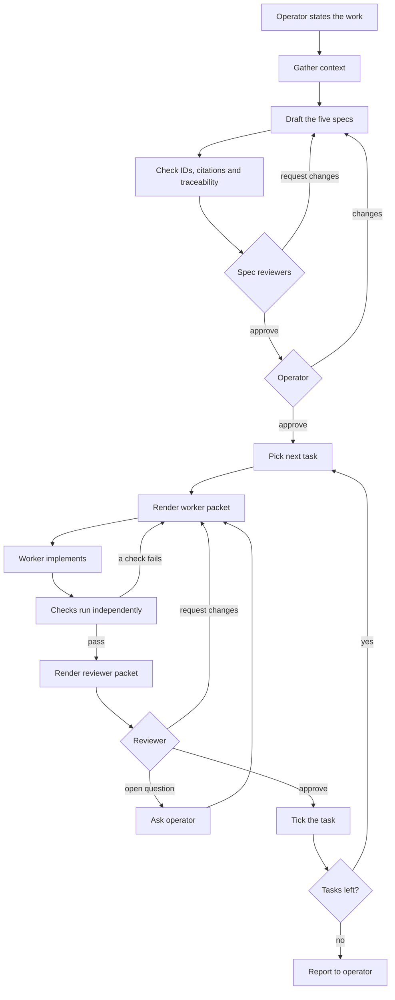

# Methodology

This document describes how work is done with Planar. It is written for
people and is kept in step with the system: when the method changes, this
document changes with it.

> **Status.** Planar is being built. This document describes the method as
> decided so far. Planar itself is being built with this method, so expect it
> to change as that work shows what holds up.

For the parts the method uses, see [architecture.md](architecture.md).

## The idea

Long-running work fails when the understanding of it lives in one
conversation. Planar moves that understanding into Markdown specs, then
executes the work in small tasks. Each task is done by a worker that sees
only what the specs give it, and judged by a reviewer that did not write it.

The method has two phases:

1. **Specs.** Agree what is being built, in writing, before building it.
2. **Execution.** Build it one task at a time, with independent review.

## Roles

- **Operator.** The person directing the work. Answers open questions,
  approves the specs and decides what merges.
- **Session.** The Claude Code session the operator is talking to. Runs the
  skills and reports. Under the minimal profile it also drives the loop.
- **Orchestrator.** An agent that drives the loop and keeps the task
  records, under the basic profiles.
- **Spec checker** and **spec reviewer.** Agents that check and judge a spec
  set before the operator is asked to approve it.
- **Planner** and **mapper.** Agents that write each task's plan and symbol
  map, under the basic profiles.
- **Worker.** An agent that implements one task.
- **Reviewer.** An agent that judges one task's result.
- **Decider.** An agent that takes the operator's decisions in an
  autonomous run, within limits.

No role approves its own work. Whoever drives the loop does not review, the
worker does not approve, and no reviewer makes the fixes it asks for.

## Phase 1: specs

### 1. Name the project

The work gets a project name and a directory. The name is derived from
context unless settings or the operator say otherwise. The operator is told
the name before anything is written, and is asked what to do if it is
already taken.

### 2. Gather context

Before drafting, the orchestrator collects what the specs will cite: the
relevant code, existing documents and what the operator has said. Specs make
claims, and claims need sources.

### 3. Draft the five specs

The specs are drafted in order, each building on the last:

1. **PRD**: what is wanted and why, with acceptance scenarios in Gherkin.
2. **Tech spec**: how it will be built.
3. **Layout**: the files and directories involved.
4. **Testing spec**: how each requirement is checked.
5. **Tasks**: ordered units of work, each small enough for one worker.

While drafting:

- give every referable section a stable ID;
- cite a source for every factual claim, or mark it as an assumption;
- write down open questions instead of guessing, and record the operator's
  answers with the date.

### 4. Check IDs, citations and traceability

Before review, a check confirms that:

- every section ID is unique;
- no existing ID has changed or disappeared without being marked withdrawn;
- every citation resolves to a real section, file or decision;
- every requirement is built by a task and tested by a check, or says why
  not; every task cites what it implements; every check is used.

A spec set that fails this check does not go to review.

### 5. Spec review

Separate spec-review agents read the set adversarially. The project's
profile says how many there are and what each looks at. There are three
standard focuses:

| Focus | Looks for |
| --- | --- |
| Intent | Each thing the operator asked for, matched to the sections that carry it out, or reported as a gap. Also anything specified that nobody asked for, and questions that should have been asked. |
| Consistency | Places where the specs disagree, requirements nothing implements, parts no task builds, and checks that could not actually fail. |
| Feasibility | Steps that cannot be done as written, and claims about the platform or codebase that need to be tried first. |

The minimal profile uses one reviewer for all three; the basic profile uses
one each. A project can add lenses for what its work touches: API and
interfaces, security, and stored data and migration.

Each reviewer writes its own report and returns approve or request changes.
If any asks for changes, the set goes back to drafting. No reviewer
rewrites the specs. On later rounds a reviewer first says which of its
earlier findings are closed, then looks only at what changed.

### 6. Operator approval

Only after every spec reviewer approves is the operator asked to approve.
Execution does not start without both.

## Phase 2: execution

The work is done in a git worktree for the project, on its own branch, so
the operator's checkout is left alone. Which stages run depends on the
project's **profile**. The steps below are the ones every profile has; the
basic profiles add two before them:

- **Plan.** Once, after approval, a planner writes an implementation plan
  for every task it can. A plan is refreshed later if the files it names
  have changed. If the planner finds a task cannot be done as specified, it
  says so before any coding starts.
- **Map.** Before a task is coded, a mapper writes its symbol map: what to
  change, where new code goes and what to imitate. The worker may change
  only what the map names.

Tasks are taken from the task list in order. Under a parallel profile, all
the tasks that are ready and touch different files are coded at the same
time, then checked and reviewed. For each task:

### 1. Render the worker packet

The packet holds the task, the spec sections it cites, the files it may
touch and the checks it must pass. It is written so that a worker with no
other context can do the task.

### 2. The worker implements

The worker makes the change and returns it. It does not mark the task done
and does not approve its own work.

### 3. The checks are run independently

The checks named in the testing spec for this task are run by someone other
than the worker: the orchestrator in skill mode, a check-runner agent in
workflow mode. The worker's own report of the results is not used.

If a check fails, no reviewer is dispatched at all: the task goes straight
back to a worker with the check output.

### 4. Render the reviewer packet

This packet holds the task, the cited spec sections, the diff and the check
results from that independent run.

### 5. The reviewer judges

Each reviewer returns one verdict, with findings that cite spec sections. A
profile may have several reviewers looking at different things; if any of
them asks for changes, the task goes back.

| Verdict | What happens next |
| --- | --- |
| Approve | The task's checkbox is ticked in the task list and, under the default policy, the change is committed. |
| Request changes | The task goes back to a worker with the findings, on a stronger model if the profile has one. There is no limit on rounds by default, but if the same finding is raised on two attempts running, the loop stops and escalates. |
| Open question | The operator is asked (or the decider, in an autonomous run), the answer is recorded in the spec, and the task continues. |

### Recording as you go

Every step above is written to the task's own record as it happens: the
packets, each attempt, the check results and each verdict. The task list is
touched only once, when the task is approved.

## Stopping and resuming

Work is expected to stop partway: sessions end, context runs out, people go
home. To continue, a new session:

1. reads the task list to find the first task that is not ticked;
2. reads that task's record to see how far it got;
3. picks up at the next step, without repeating finished ones.

For example, if the record shows the worker finished and the checks have not
run, the new session runs the checks. It does not dispatch the worker again.

## Changing a spec after approval

Approval is of the exact text, apart from ticking tasks off. If any spec
changes afterwards, the run stops. A change goes back through the ID and
citation check, and the operator then either signs off a small amendment,
such as a typo, or sends a changed requirement back through spec review.

An answer the operator gives to a question during a run is its own
sign-off: it is written into the spec and the task record, and the run
continues. In an autonomous run the decider can answer questions and adjust
task entries, never requirements, and the operator is shown each one.

## Autonomous runs

By default a run stops whenever a decision is the operator's. If the
operator asks for an autonomous run, a decider agent takes those decisions
instead, up to a set number per run, and records each with its reasoning.
The decider never approves a spec set, pushes, merges or changes settings.
At the end of the run the operator is shown what was decided.

## Skill mode and workflow mode

The execution loop can be run by Planar's own orchestration skill or by a
Claude Code dynamic workflow. The steps, packets, agents and records are the
same in both, and both read the same profile. Skill mode is the default; use
workflow mode where workflows are available and allowed. A task can be started in one and finished in
the other.

## Replication

If replication is turned on for the project, its Planar files are copied into
the repository: first when the operator approves the spec set, then again
each time a task completes. It is off unless the operator turns it on.

## When the method falls short

Planar has no engine by choice. When a step goes wrong, or goes slowly, in a
way that validation, identities or a database would have prevented, the
orchestrator writes the gap down with the evidence: what happened, what it
cost and what would have helped. It does not build the missing tool.

The record of gaps is reviewed after the first release. Tooling is added only
where that record shows it is needed.

## Keeping these documents true

`architecture.md` and `methodology.md` describe the system as it is. A change
to how Planar works is not finished until these two documents say the same
thing.
