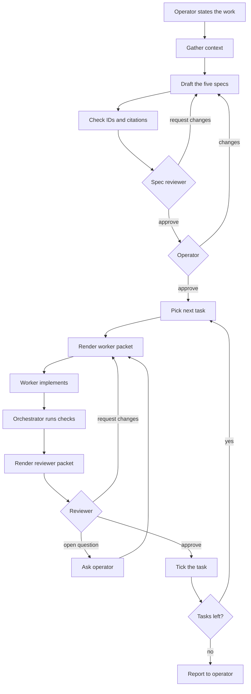

# Methodology

This document describes how work is done with Planar. It is written for
people and is kept in step with the system: when the method changes, this
document changes with it.

> **Status.** Planar is being built. This document describes the method as
> decided so far. Planar itself is being built with this method, so expect it
> to change as that work shows what holds up.

For the parts the method uses, see [architecture.md](architecture.md).

## The idea

Long-running work fails when the understanding of it lives in one
conversation. Planar moves that understanding into Markdown specs, then
executes the work in small tasks. Each task is done by a worker that sees
only what the specs give it, and judged by a reviewer that did not write it.

The method has two phases:

1. **Specs.** Agree what is being built, in writing, before building it.
2. **Execution.** Build it one task at a time, with independent review.

## Roles

- **Operator.** The person directing the work. Answers open questions,
  approves the specs and decides what merges.
- **Orchestrator.** The session the operator is talking to. Runs the skills,
  dispatches agents, runs checks and reports.
- **Spec reviewer.** An agent that judges a spec set before the operator is
  asked to approve it.
- **Worker.** An agent that implements one task.
- **Reviewer.** An agent that judges one task's result.

No role approves its own work. The orchestrator does not review, the worker
does not approve, and neither reviewer makes the fixes it asks for.

## Phase 1: specs

### 1. Name the project

The work gets a project name and a directory. The name is derived from
context unless settings or the operator say otherwise. The operator is told
the name before anything is written, and is asked what to do if it is
already taken.

### 2. Gather context

Before drafting, the orchestrator collects what the specs will cite: the
relevant code, existing documents and what the operator has said. Specs make
claims, and claims need sources.

### 3. Draft the five specs

The specs are drafted in order, each building on the last:

1. **PRD**: what is wanted and why, with acceptance scenarios in Gherkin.
2. **Tech spec**: how it will be built.
3. **Layout**: the files and directories involved.
4. **Testing spec**: how each requirement is checked.
5. **Tasks**: ordered units of work, each small enough for one worker.

While drafting:

- give every referable section a stable ID;
- cite a source for every factual claim, or mark it as an assumption;
- write down open questions instead of guessing, and record the operator's
  answers with the date.

### 4. Check IDs and citations

Before review, a check confirms that:

- every section ID is unique;
- no existing ID has changed or disappeared without being marked withdrawn;
- every citation resolves to a real section, file or decision.

A spec set that fails this check does not go to review.

### 5. Spec review

A separate spec-review agent reads the set adversarially. It looks for
missing requirements, places where the specs do not match what the operator
asked for, unanswered questions and requirements with no test. It returns
approve or request changes. It does not rewrite the specs.

### 6. Operator approval

Only after the spec reviewer approves is the operator asked to approve.
Execution does not start without both.

## Phase 2: execution

Tasks are taken from the task list in order. For each task:

### 1. Render the worker packet

The packet holds the task, the spec sections it cites, the files it may
touch and the checks it must pass. It is written so that a worker with no
other context can do the task.

### 2. The worker implements

The worker makes the change and returns it. It does not mark the task done
and does not approve its own work.

### 3. The orchestrator runs the checks

The checks named in the testing spec for this task are run by the
orchestrator. The worker's own report of the results is not used.

### 4. Render the reviewer packet

This packet holds the task, the cited spec sections, the diff and the check
results from the orchestrator's run.

### 5. The reviewer judges

The reviewer returns one verdict, with findings that cite spec sections:

| Verdict | What happens next |
| --- | --- |
| Approve | The task's checkbox is ticked in the task list. |
| Request changes | The task goes back to a worker with the findings. |
| Open question | The operator is asked, the answer is recorded in the spec, and the task continues. |

### Recording as you go

Every step above is written to the task's own record as it happens: the
packets, each attempt, the check results and each verdict. The task list is
touched only once, when the task is approved.

## Stopping and resuming

Work is expected to stop partway: sessions end, context runs out, people go
home. To continue, a new session:

1. reads the task list to find the first task that is not ticked;
2. reads that task's record to see how far it got;
3. picks up at the next step, without repeating finished ones.

For example, if the record shows the worker finished and the checks have not
run, the new session runs the checks. It does not dispatch the worker again.

## Skill mode and workflow mode

The execution loop can be run by Planar's own orchestration skill or by a
Claude Code dynamic workflow. The steps, packets, agents and records are the
same in both. Use workflow mode where workflows are available and allowed,
and skill mode everywhere else. A task can be started in one and finished in
the other.

## Replication

If replication is turned on for the project, its Planar files are copied into
the repository: first when the operator approves the spec set, then again
each time a task completes. It is off unless the operator turns it on.

## When the method falls short

Planar has no engine by choice. When a step goes wrong, or goes slowly, in a
way that validation, identities or a database would have prevented, the
orchestrator writes the gap down with the evidence: what happened, what it
cost and what would have helped. It does not build the missing tool.

The record of gaps is reviewed after the first release. Tooling is added only
where that record shows it is needed.

## Keeping these documents true

`architecture.md` and `methodology.md` describe the system as it is. A change
to how Planar works is not finished until these two documents say the same
thing.
